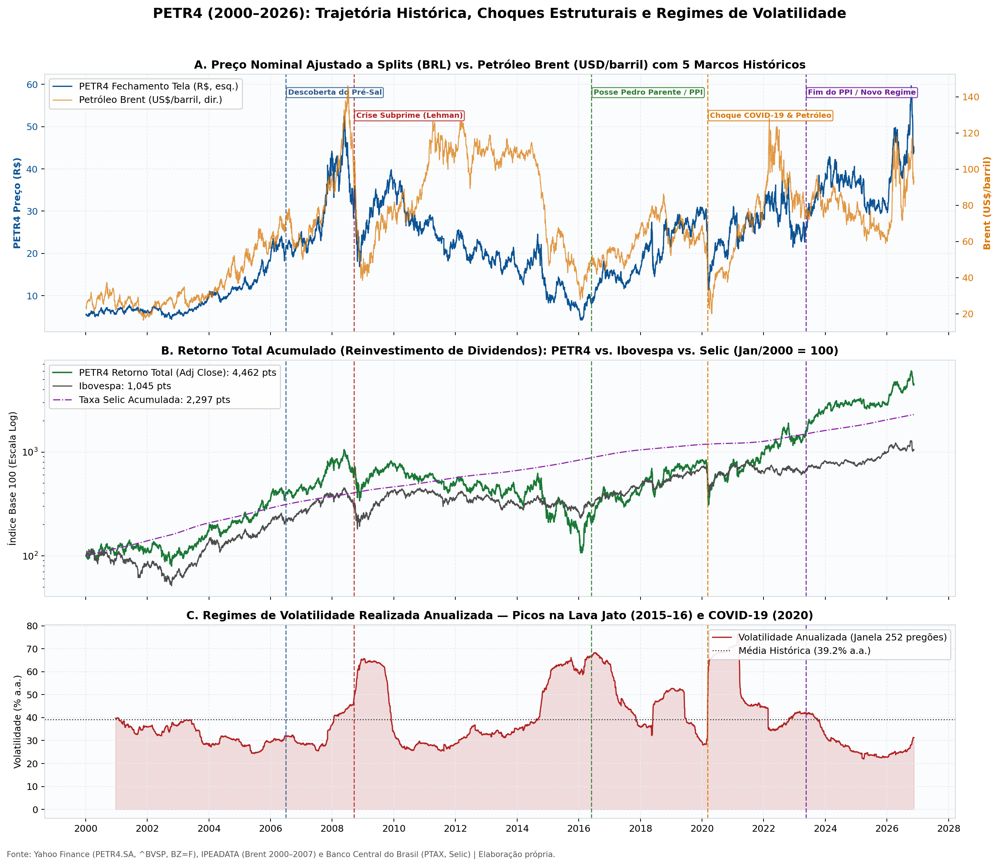
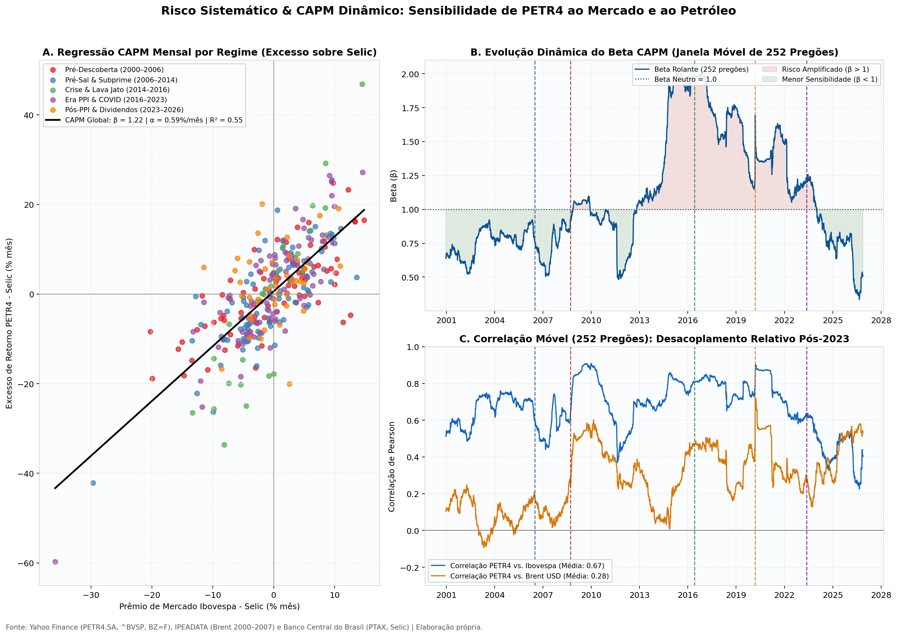
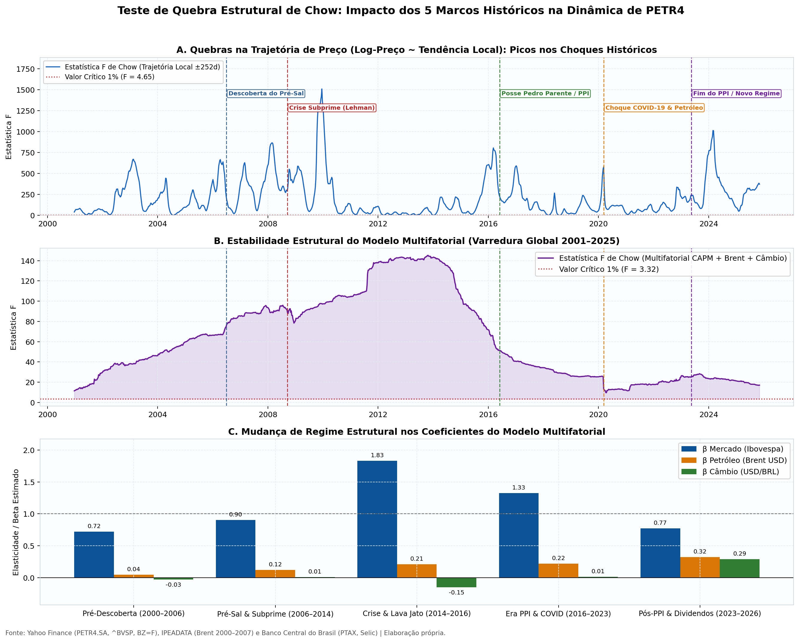
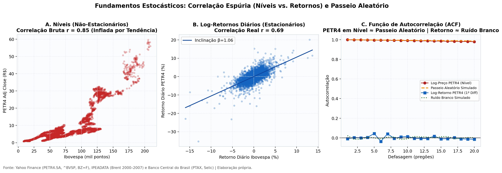
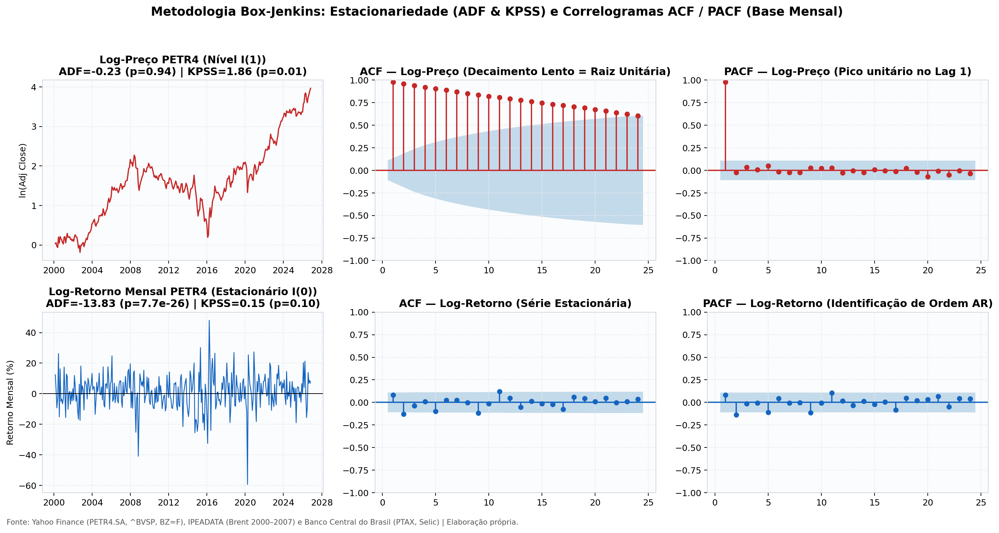
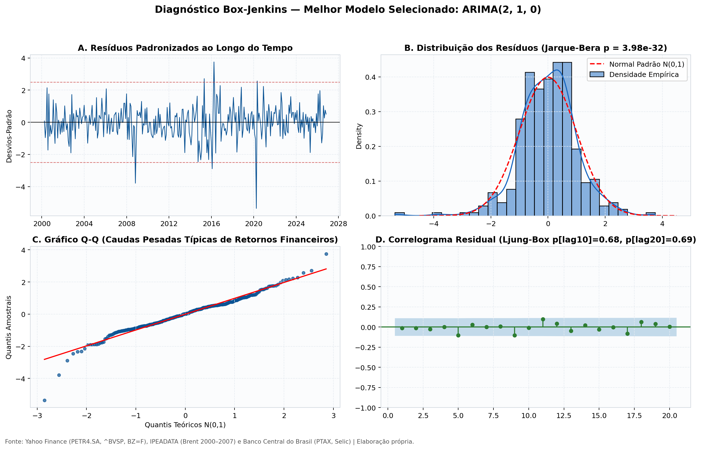
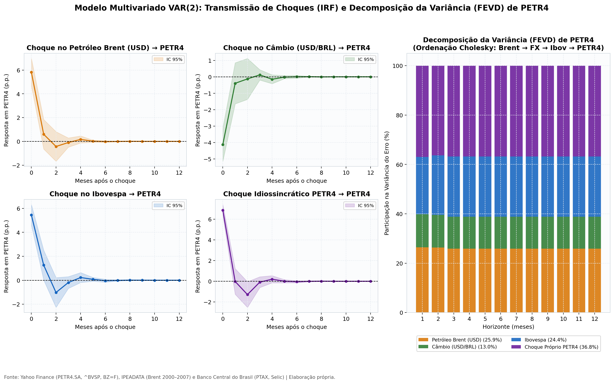
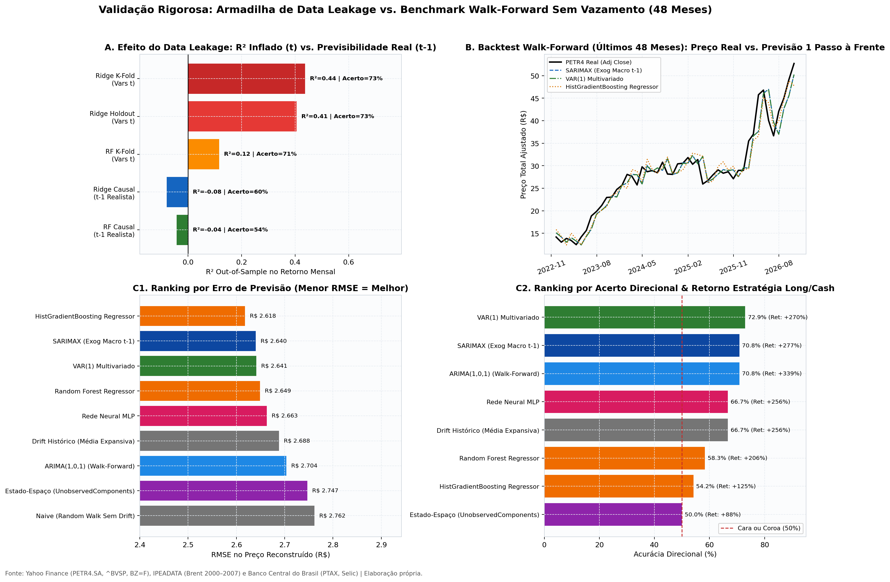
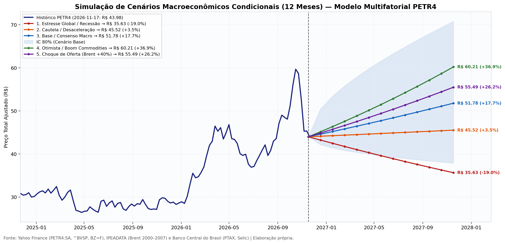

# Análise Econométrica, Séries Temporais e Machine Learning — Petrobras (`PETR4`, 2000–2026)

[](https://www.python.org/)
[](https://www.statsmodels.org/)
[](https://scikit-learn.org/)
[](#arquitetura-e-pipeline-de-dados)

> **Resumo Executivo:** Estudo **end-to-end de Econometria Financeira, Séries Temporais e Machine Learning** aplicado às ações preferenciais da Petrobras (`PETR4`), cobrindo **26 anos de mercado (jan/2000 – nov/2026)** com pipeline causal de dados, detecção de quebras estruturais, modelagem multivariada e *backtesting Walk-Forward* sem *data leakage*.

<details>
<summary><strong>🇺🇸 English Executive Summary (Click to expand)</strong></summary>

### English Executive Summary

This repository presents an end-to-end **Financial Econometrics & Data Science** case study analyzing **PETR4 (Petrobras)** from **January 2000 to November 2026** (6,744 trading days; 321 closed months).

* **Causal Data Pipeline (`src/data_pipeline.py`):** Merges Yahoo Finance (`PETR4.SA`, `^BVSP`, `BZ=F`), historical IPEADATA Brent crude (`2000–2007`), and Brazil Central Bank SGS API series (`USD/BRL PTAX`, daily/target `Selic`), strictly aligned on B3 trading days with causal forward-fill only (zero look-ahead) and handling both split-adjusted screen price (`Close`) and dividend-reinvested total return (`Adj Close`).
* **Structural Breaks & Dynamic CAPM (`src/econometrics.py`):** Implements exact OLS Chow F-tests across 5 historical milestones (*Pre-Salt 2006*, *Subprime 2008*, *Pedro Parente / PPI 2016*, *COVID-19 2020*, *End of PPI 2023*), all statistically significant ($p < 10^{-19}$ multifactor; $p < 10^{-60}$ local log-price trajectory). Rolling CAPM reveals systematic risk surging to $\beta = 1.97$ during *Lava Jato* (2014–2016) and falling to $\beta = 0.64$ in the post-PPI dividend regime (2023–2026) as Brent sensitivity climbed to $0.32$.
* **Box-Jenkins & Multivariate VAR:** Formal ADF + KPSS unit-root testing, spurious correlation demonstration ($r = 0.85$ in levels vs. $r = 0.69$ in log-returns), `ARIMA(2,1,0)` residual diagnostics (Ljung-Box $p = 0.69$), and a `VAR(2)` model with economic Cholesky ordering (`Brent → USD/BRL → Ibovespa → PETR4`), attributing **25.9%** of PETR4 forecast error variance to Brent, **24.4%** to Ibovespa, **13.0%** to FX, and **36.8%** to idiosyncratic shocks.
* **Leakage-Free Walk-Forward ML Benchmark (`src/ml_benchmark.py`):** Empirically exposes how K-Fold shuffling and contemporaneous predictors inflate $R^2$ from `-0.08` (causal $t-1$) to `+0.44` (leaked). Over a strict 48-month expanding Walk-Forward benchmark across 9 models, `VAR(1)` and `SARIMAX (t-1 exog)` achieve **72.9%** and **70.8%** directional accuracy while beating the Random Walk on price RMSE (`R$ 2.64` vs. `R$ 2.76`), and `HistGradientBoosting` attains the lowest price RMSE (`R$ 2.62`). Conditional **12-month macroeconomic scenarios** quantify return expectations under stress, consensus, and commodity-boom regimes.

</details>

---

## Sumário

1. [Escopo Metodológico — Os 5 Atos da Análise](#escopo-metodológico--os-5-atos-da-análise)
2. [Arquitetura do Repositório e Pipeline de Dados](#arquitetura-do-repositório-e-pipeline-de-dados)
3. [Ato 1 — Trajetória Histórica, Dividendos e Volatilidade (2000–2026)](#ato-1--trajetória-histórica-dividendos-e-volatilidade-20002026)
4. [Ato 2 — CAPM Dinâmico, Modelo Multifatorial e Teste F de Chow](#ato-2--capm-dinâmico-modelo-multifatorial-e-teste-f-de-chow)
5. [Ato 3 — Correlação Espúria, Passeio Aleatório e Estacionariedade](#ato-3--correlação-espúria-passeio-aleatório-e-estacionariedade)
6. [Ato 4 — Box-Jenkins (ARIMA) e Vetores Autorregressivos (VAR)](#ato-4--box-jenkins-arima-e-vetores-autorregressivos-var)
7. [Ato 5 — Armadilha de Data Leakage, Benchmark Walk-Forward e Cenários](#ato-5--armadilha-de-data-leakage-benchmark-walk-forward-e-cenários)
8. [Como Reproduzir Localmente](#como-reproduzir-localmente)

---

## Escopo Metodológico — Os 5 Atos da Análise

A investigação completa está estruturada no notebook [`PETR4_Time_Series_Analysis.ipynb`](PETR4_Time_Series_Analysis.ipynb), apoiado por módulos reutilizáveis em [`src/`](src/):

| Ato | Pilar Analítico | Técnicas e Entregas Principais |
| :--- | :--- | :--- |
| **1** | **História Econômica & Regimes de Volatilidade** | Pipeline diário e mensal (**jan/2000 – nov/2026**: 6.744 pregões / 321 meses), separação `Close` (tela) vs. `Adj Close` (retorno total com dividendos) e análise dos 5 marcos estruturais |
| **2** | **CAPM Dinâmico & Teste F de Chow** | CAPM e modelo multifatorial (**Ibovespa + Brent + USD/BRL**) com erros **HAC Newey-West**, **Beta Rolante (252d)** e **Teste F de Chow** pontual e rolante (estilo Quandt-Andrews) |
| **3** | **Estocástica & Estacionariedade** | Demonstração de **Correlação Espúria** (níveis vs. retornos), simulação **Passeio Aleatório vs. Ruído Branco**, bateria **ADF + KPSS** e painéis **ACF/PACF** |
| **4** | **Econometria Univariada & Multivariada** | Seleção Box-Jenkins **`ARIMA(2,1,0)`** com diagnóstico Ljung-Box/Jarque-Bera e **`VAR(2)`** com ordenação Cholesky econômica, **Causalidade de Granger, IRF e FEVD** |
| **5** | **ML Benchmark, Data Leakage & Cenários** | Prova empírica de **Data Leakage**, *backtesting* **Walk-Forward** (9 modelos causais) e **Simulação de Cenários Macroeconômicos (12m)** com intervalos de confiança |

---

## Arquitetura do Repositório e Pipeline de Dados

```text
Series Temporais PETR4/
├── README.md                                  # Documentação executiva bilíngue com resultados e gráficos
├── PETR4_Time_Series_Analysis.ipynb           # Notebook principal unificado (5 Atos, executado ponta a ponta)
├── requirements.txt                           # Dependências reproduzíveis
├── src/
│   ├── data_pipeline.py                       # Coleta (Yahoo Finance + IPEADATA + BCB SGS em blocos de 10 anos)
│   ├── econometrics.py                        # ADF/KPSS, Teste de Chow, CAPM/HAC, ARIMA e VAR/Granger/IRF/FEVD
│   ├── ml_benchmark.py                        # Walk-Forward (9 modelos), Data Leakage demo e Cenários 12m
│   └── visualization.py                       # Geração padronizada dos 9 painéis em 180 DPI
├── data/
│   ├── raw/                                   # Snapshots brutos (brent.xlsx, PETR4.SA.csv, BCB SGS, Yahoo)
│   └── processed/
│       ├── petr4_macro_daily.csv              # 6.744 pregões (2000-01-05 a 2026-11-17)
│       └── petr4_macro_monthly.csv            # 321 meses fechados (2000-02-29 a 2026-10-31)
└── reports/figures/                           # 9 gráficos PNG em alta resolução
```

**Destaques de Engenharia de Dados em [`src/data_pipeline.py`](src/data_pipeline.py):**
* **Contorno ao bug de Horário de Verão (`yfinance`):** A coleta contínua de ativos da B3 a partir de 2000 falha em `2004-11-02` (`NonExistentTimeError` no fuso `America/Sao_Paulo`); a função `fetch_yfinance_b3_safe` divide a requisição em torno do feriado de Finados sem perda de pregões.
* **Coleta paginada no Banco Central (API SGS):** A API bloqueia janelas superiores a 10 anos para séries diárias; `fetch_bcb_sgs_chunked` consulta automaticamente em blocos decenais (`USD/BRL PTAX` série 1, `Selic diária` série 11 e `Meta Selic` série 432).
* **Série contínua do Brent (2000–2026):** Combina a série histórica IPEADATA de 2000–2007 (`data/raw/brent.xlsx`) com o contrato futuro `BZ=F` do Yahoo Finance (2007–2026).

---

## Ato 1 — Trajetória Histórica, Dividendos e Volatilidade (2000–2026)

| Série Analisada (2000-01-05 a 2026-11-17) | Retorno Acumulado | CAGR Anualizado | Volatilidade Anualizada |
| :--- | :---: | :---: | :---: |
| **PETR4 Retorno Total (`Adj Close`)** | **+4.361,9%** | **15,25% a.a.** | 41,16% |
| **PETR4 Preço de Tela (`Close`)** | +700,5% | 8,08% a.a. | 41,51% |
| **Ibovespa (`^BVSP`)** | +945,4% | 9,17% a.a. | 26,79% |
| **Selic Acumulada (Renda Fixa)** | +2.197,0% | 12,42% a.a. | 0,28% |
| **Petróleo Brent (USD)** | +292,7% | 5,24% a.a. | 42,13% |

A discrepância entre o retorno nominal de tela (+700,5%) e o retorno total ajustado a dividendos (+4.361,9%) evidencia o peso estrutural da distribuição de proventos a partir de 2021 na tese de investimento da companhia.



---

## Ato 2 — CAPM Dinâmico, Modelo Multifatorial e Teste F de Chow

### Evolução do Risco por Regime Político-Econômico

| Regime Histórico | Pregões | Retorno Anualizado | Volatilidade Anual | $\beta$ CAPM | $R^2$ CAPM | $\beta_{\text{Ibov}}$ Multi | $\beta_{\text{Brent}}$ Multi | $R^2$ Multi |
| :--- | :---: | :---: | :---: | :---: | :---: | :---: | :---: | :---: |
| **Pré-Descoberta (2000–2006)** | 1.681 | +23,1% | 33,4% | 0,73 | 0,392 | 0,72 | 0,04 | 0,397 |
| **Pré-Sal & Subprime (2006–2014)** | 1.909 | -3,7% | 38,2% | 0,95 | 0,535 | 0,90 | 0,12 | 0,547 |
| **Crise & Lava Jato (2014–2016)** | 543 | -15,9% | **63,7%** | **1,97** | 0,652 | **1,83** | 0,21 | 0,672 |
| **Era PPI & COVID (2016–2023)** | 1.734 | +33,9% | 47,4% | 1,43 | 0,592 | 1,33 | 0,22 | 0,627 |
| **Pós-PPI & Dividendos (2023–2026)** | 877 | **+35,2%** | **27,5%** | **0,64** | 0,172 | **0,77** | **0,32** | 0,397 |

* **CAPM Global Mensal (HAC Newey-West):** $\beta = 1{,}224$ ($z = 11{,}33, p < 0{,}001$), $\alpha = +0{,}59\%/\text{mês}$ ($p = 0{,}165$), $R^2_{\text{ajust}} = 0{,}552$.
* **Multifatorial Mensal (HAC):** $\beta_{\text{Ibov}} = 1{,}086$ ($p < 0{,}001$) e $\beta_{\text{Brent}} = 0{,}271$ ($z = 6{,}42, p < 0{,}001$), elevando o $R^2_{\text{ajust}}$ para `0,615`. No regime **Pós-PPI (2023–2026)**, a sensibilidade ao Ibovespa recuou para `0,64` enquanto o peso do Brent saltou para `0,32`.



### Teste F de Chow nos 5 Marcos Históricos

Todos os cinco eventos testados apresentaram **quebra estrutural estatisticamente significativa ao nível de 1%**:

| Marco Histórico | Data | $F$ Trajetória Local ($\pm 252$d) | $F$ Multifatorial Completo | $\beta_{\text{Ibov}}$ (Pré $\rightarrow$ Pós) | $\beta_{\text{Brent}}$ (Pré $\rightarrow$ Pós) |
| :--- | :---: | :---: | :---: | :---: | :---: |
| **Descoberta do Pré-Sal** | `2006-07-01` | `195,48` ($p \approx 0$) | `76,60` ($p \approx 0$) | $0{,}72 \rightarrow 1{,}11$ | $0{,}04 \rightarrow 0{,}22$ |
| **Crise Subprime (Lehman)** | `2008-09-15` | `303,18` ($p \approx 0$) | `89,51` ($p \approx 0$) | $0{,}74 \rightarrow 1{,}15$ | $0{,}06 \rightarrow 0{,}23$ |
| **Posse Pedro Parente / PPI** | `2016-05-30` | `231,74` ($p \approx 0$) | `51,42` ($p \approx 0$) | $0{,}93 \rightarrow 1{,}20$ | $0{,}11 \rightarrow 0{,}27$ |
| **Choque COVID-19 & Petróleo** | `2020-03-09` | `644,98` ($p \approx 0$) | `23,92` ($p \approx 0$) | $0{,}98 \rightarrow 1{,}11$ | $0{,}12 \rightarrow 0{,}28$ |
| **Fim do PPI / Novo Regime** | `2023-05-16` | `244,69` ($p \approx 0$) | `25,55` ($p \approx 0$) | $1{,}02 \rightarrow 0{,}77$ | $0{,}14 \rightarrow 0{,}32$ |



---

## Ato 3 — Correlação Espúria, Passeio Aleatório e Estacionariedade

Em nível diário, `PETR4` e `Ibovespa` exibem correlação de **0,8509**, parcialmente inflada pela tendência estocástica comum ($I(1)$). Nos **log-retornos diários** estacionários ($I(0)$), a correlação genuína é **0,6877** (e **0,3003** contra o Brent USD).



Os testes combinados **ADF** e **KPSS** confirmam que os preços e log-preços possuem raiz unitária $I(1)$ (ADF $p > 0{,}86$; KPSS $p = 0{,}01$), enquanto os log-retornos de `PETR4`, `Ibovespa`, `Brent` e `USD/BRL` são estacionários $I(0)$ (ADF $p < 10^{-19}$; KPSS $p = 0{,}10$).



---

## Ato 4 — Box-Jenkins (ARIMA) e Vetores Autorregressivos (VAR)

* **Seleção Box-Jenkins (`log_petr4_adj` mensal):** A busca em grade selecionou **`ARIMA(2,1,0)`** (`AIC = -481,85`, `BIC = -470,55`). O teste **Ljung-Box** nos resíduos confirma ausência de autocorrelação serial remanescente até 20 defasagens ($p = 0{,}58$ no lag 5; $p = 0{,}68$ no lag 10; $p = 0{,}69$ no lag 20), enquanto o teste **Jarque-Bera** ($p = 3{,}98 \times 10^{-32}$) reflete as caudas pesadas clássicas de retornos acionários.



* **Modelo Multivariado `VAR(2)` (Brent $\rightarrow$ USD/BRL $\rightarrow$ Ibovespa $\rightarrow$ PETR4):**
  * **Causalidade de Granger:** Evidência significativa (5%) de causalidade de `ret_ibov` $\rightarrow$ `ret_usd_brl` ($F = 4{,}70, p = 0{,}009$) e de `ret_petr4` $\rightarrow$ `ret_ibov` ($F = 3{,}38, p = 0{,}035$), coerente com o fato de choques na maior petrolífera local antecederem ou se propagarem no índice agregado em janela mensal.
  * **Decomposição da Variância (FEVD, horizonte 12 meses):** Com ordenação Cholesky econômica, **25,86%** da variância do erro de previsão de `PETR4` provém do **Petróleo Brent**, **24,38%** do **Ibovespa**, **12,96%** do **Câmbio USD/BRL** e **36,80%** de choques idiossincráticos da própria estatal.



---

## Ato 5 — Armadilha de Data Leakage, Benchmark Walk-Forward e Cenários

### 1. O Impacto Real do *Data Leakage*
Ao replicar a prática comum de treinar modelos usando validação **K-Fold aleatória** e/ou variáveis contemporâneas no tempo $t$ (`ret_ibov_t`, `ret_brent_t`), o `Ridge` exibe um $R^2$ artificial de **+0,4375** (`72,9%` de acerto direcional). Ao corrigir para o cenário ex-ante realista usando apenas *features* causais disponíveis até $t-1$, o $R^2$ cai para **-0,0792** (`Ridge`) e **-0,0422** (`Random Forest`) — demonstrando por que o rigor temporal é indispensável em finanças quantitativas.

### 2. Benchmark *Walk-Forward* Sem Vazamento (Últimos 48 Meses — Buy & Hold: +255,51%)

| Modelo | Categoria | RMSE Preço (R$) | MAE Preço (R$) | MAPE (%) | Acurácia Direcional | Retorno Long/Cash |
| :--- | :--- | :---: | :---: | :---: | :---: | :---: |
| **HistGradientBoosting Regressor** | Machine Learning | **2,618** | 1,933 | 7,05% | 54,2% | +125,0% |
| **SARIMAX (Exog Macro $t-1$)** | Econométrico Exógeno | 2,640 | **1,880** | 6,48% | **70,8%** | **+276,6%** |
| **VAR(1) Multivariado** | Econométrico Multivariado | 2,641 | 1,881 | **6,48%** | **72,9%** | **+269,8%** |
| **Random Forest Regressor** | Machine Learning | 2,649 | 1,897 | 6,66% | 58,3% | +206,4% |
| **Rede Neural MLP** | Deep Learning (MLP) | 2,663 | 1,929 | 6,65% | 66,7% | +255,5% |
| **Drift Histórico (Média Expansiva)** | Baseline | 2,688 | 1,929 | 6,62% | 66,7% | +255,5% |
| **ARIMA(1,0,1) (Walk-Forward)** | Econométrico Univariado | 2,704 | 1,948 | 6,70% | **70,8%** | **+338,9%** |
| **Estado-Espaço (`UnobservedComponents`)** | Estado-Espaço | 2,747 | 1,991 | 6,85% | 50,0% | +87,5% |
| **Naive (Random Walk Sem Drift)** | Baseline | 2,762 | 2,004 | 6,79% | — | 0,0% |



### 3. Simulação de Cenários Macroeconômicos Condicionais (12 Meses)
Tomando como referência o fechamento ajustado em **17/11/2026 (R$ 43,98)** e **Selic Meta de 13,75% a.a.**, as elasticidades do Modelo Multifatorial projetam:

| Cenário (12 Meses) | Ibovespa | Brent (USD) | USD/BRL | Selic Final | Retorno Esperado PETR4 | Preço-Alvo Implícito | IC 80% |
| :--- | :---: | :---: | :---: | :---: | :---: | :---: | :---: |
| **1. Estresse Global / Recessão** | -15% | -25% | +15% | 15,25% | **-19,0%** | **R$ 35,63** | R$ 26,05 – R$ 48,73 |
| **2. Cautela / Desaceleração** | +2% | -10% | +5% | 13,75% | **+3,5%** | **R$ 45,52** | R$ 33,29 – R$ 62,25 |
| **3. Base / Consenso Macro** | +12% | 0% | 0% | 12,75% | **+17,7%** | **R$ 51,78** | R$ 37,86 – R$ 70,81 |
| **4. Otimista / Boom Commodities** | +22% | +25% | -8% | 11,75% | **+36,9%** | **R$ 60,21** | R$ 44,03 – R$ 82,34 |
| **5. Choque de Oferta (Brent +40%)** | +10% | +40% | -5% | 14,25% | **+26,2%** | **R$ 55,49** | R$ 40,58 – R$ 75,88 |



---

## Como Reproduzir Localmente

```bash
# 1. Clonar e acessar o diretório
cd "Series Temporais PETR4"

# 2. Instalar dependências
pip install -r requirements.txt

# 3. Atualizar a coleta de dados (opcional — os CSVs processados já estão em data/processed/)
python -m src.data_pipeline

# 4. Abrir e executar o notebook principal
jupyter lab PETR4_Time_Series_Analysis.ipynb
```

> **Nota sobre isenção financeira:** Este projeto tem finalidade estritamente educacional, econométrica e demonstrativa de ciência de dados, não constituindo recomendação de compra ou venda de ativos mobiliários.
